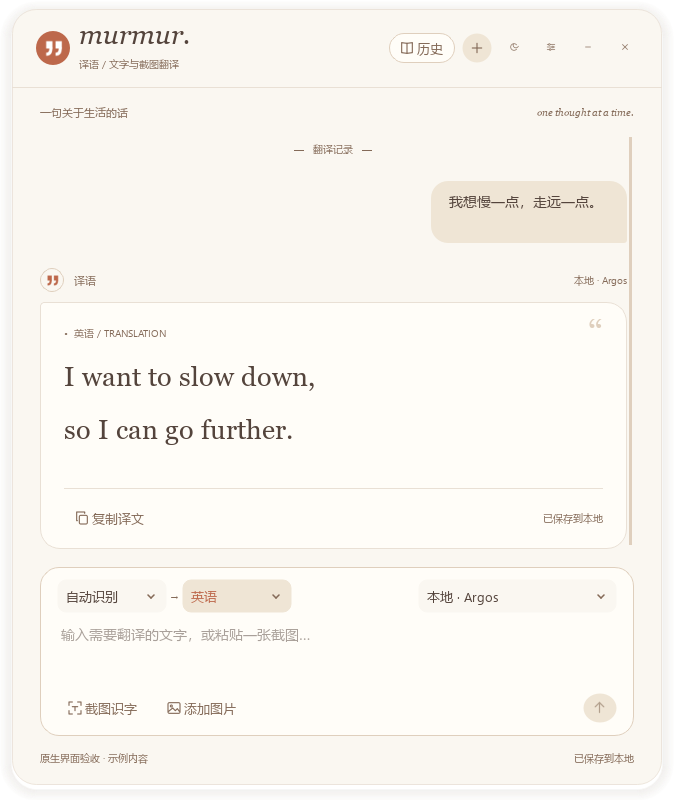
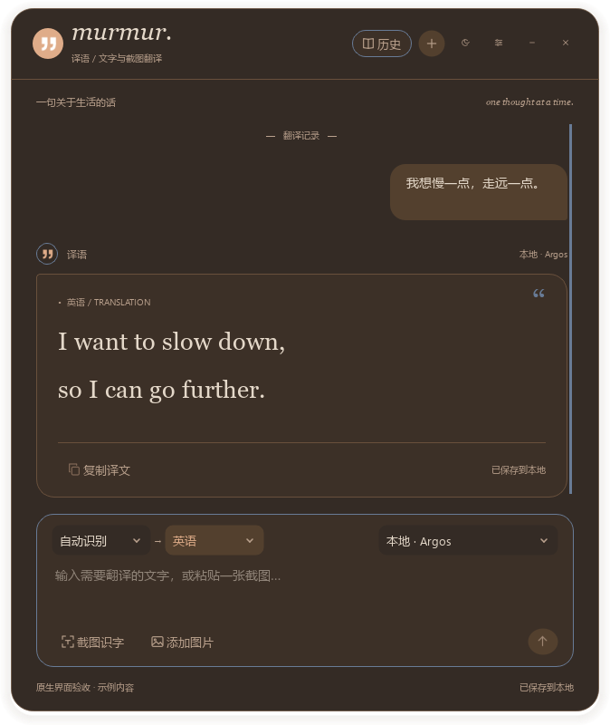

# Murmur（译语）

Windows x64 桌面翻译工具，当前版本 **0.5.0**。输入文字、截图取词或添加图片，在聊天小窗中查看翻译并保存本地会话。OCR 在本机执行；翻译可使用 Argos 中英离线模型，或个人账户直连在线平台。

目前提供源码与构建工具，可按仓库脚本生成本地便携包和安装包，尚未公开发布安装包。支持范围为 Windows 10/11 x64；验证环境为 Python 3.14.7。Windows ARM、macOS、Linux 和其他 Python 版本尚未完成验证。

<p>
  
  
</p>

截图来自隔离配置的真实 Qt 界面，使用示例内容，不代表离线模型的实际翻译质量。截图识字与文字校对示例见[使用指南](docs/usage.md)。

在线平台包括腾讯 TokenHub、百度翻译、阿里云机器翻译、华为 NLP 和小牛通用文本 Flash。语种列表随平台变化，支持中文名、英文名或代码搜索；离线模型和 OCR 的语言能力单独说明。使用在线平台请参考[在线平台配置](docs/providers.md)自行配置，项目不提供共享密钥或免费额度。

## 快速开始

当前从源码运行，在仓库根目录执行：

```powershell
py -3.14 -m venv .venv
.venv\Scripts\python.exe -m pip install -r requirements.lock setuptools==84.0.0
.venv\Scripts\python.exe -m pip install -e . --no-deps --no-build-isolation
.venv\Scripts\python.exe scripts\prepare_models.py
.venv\Scripts\python.exe -m screen_translator.app
```

依赖安装与首次模型准备需要联网，之后 OCR 和 Argos 可离线运行。环境与模型不提交到 Git。完成准备后，也可运行 `start-translator.bat` 启动；`start-translator.bat --check` 仅检查启动环境，不打开窗口。

后续安装包会包含运行环境与模型，普通用户无需安装 Python。

## 常用操作

- 输入原文后发送翻译，或按 `Ctrl+Enter`。
- 按 `Ctrl+Alt+S` 在鼠标所在显示器截图取词，校对识别内容后确认放入输入框。
- 输入区支持添加图片和粘贴图片。
- 历史入口支持搜索、打开和删除本地会话。
- 关闭主窗口后显示可拖动的浮动图标，双击恢复窗口；通过托盘菜单退出程序。
- 设置中配置在线平台、字体和外观。平台密钥保存在 Windows 系统凭据存储中。

## 项目结构

| 路径 | 用途 |
| --- | --- |
| `src/screen_translator/` | 应用入口、界面、领域逻辑、服务与运行自检 |
| `tests/` | 当前功能的行为与集成测试 |
| `scripts/` | 模型准备、界面预览及 Windows 构建工具 |
| `docs/` | 使用、架构、平台与隐私说明 |
| `LICENSES/` | 第三方组件的许可正文 |
| `app-icon/` | 应用图标源文件与导出工具 |
| `models/` | 本地 OCR 和 Argos 模型，Git 忽略模型文件 |
| `.venv/` | 本地 Python 环境，Git 忽略 |
| `build/`、`dist/` | 可再生成的验证与构建输出，Git 忽略 |

## 开发与文档

```powershell
.venv\Scripts\python.exe scripts\check_ci.py
```

[使用指南](docs/usage.md) · [代码架构](docs/architecture.md) · [在线平台配置](docs/providers.md) · [参与开发](CONTRIBUTING.md)


最小 Windows CI 使用固定版本的 Actions、锁定运行依赖和读取权限，执行语法、文本规则、模拟平台协议、隔离配置及图标/资源检查。不下载模型、不调用付费接口、不生成安装包。相同检查可用上面的命令在本地执行；

反馈问题时说明版本、Windows 和显示缩放、复现步骤、预期与实际结果；先移除私人内容。使用 Issue 模板，安全问题遵循 [SECURITY.md](SECURITY.md)。[隐私与本地数据](docs/privacy.md)说明原文何时发送、会话保存位置及清理方法。

## 许可

项目自有代码、文档和图标采用 [MIT](LICENSE)，可自由使用、修改、分发和商业使用，只需保留版权与许可声明。第三方组件和模型保留各自许可与署名；完整说明见[许可与分发](docs/licensing.md)与[第三方声明](THIRD_PARTY_NOTICES.md)。

当前仅面向 Windows 桌面。截图取词限于单个显示器；离线翻译质量需要人工复核。混合 DPI、多显示器与不同 Windows 环境的适用性需要在目标机器验证。
