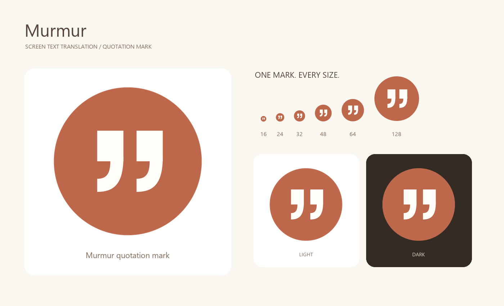

# 应用图标资产

`translator.svg` 是棕色圆底、暖白引号图标的唯一设计源。`translator.png` 为 1024×1024 RGBA 图，`translator.ico` 包含 16、20、24、32、40、48、64、128、256 九种尺寸，四角透明。`preview.png` 展示不同尺寸与背景效果。

从仓库根目录重新导出：

```powershell
.venv\Scripts\python.exe app-icon\export.py
.venv\Scripts\python.exe -m unittest discover -s tests -p test_app_assets.py -v
```

PNG 和各 ICO 尺寸由 SVG 独立渲染。应用、窗口、托盘与打包 EXE、安装程序统一加载本目录的 ICO；浅色和深色主题保持同一应用图标。界面内的菜单和浮动入口使用相同引号轮廓。


