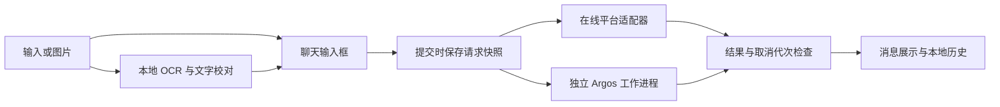

# 代码架构

应用采用 Python、PySide6、RapidOCR / ONNX Runtime、httpx 与 Argos。界面负责交互与任务协调，服务负责 I/O 和模型调用，核心模块负责文本规则。

## 阅读入口

| 模块 | 职责 |
| --- | --- |
| `app.py` | 命令行入口、单实例、全局快捷键和应用生命周期 |
| `ui/main_window.py` | 聊天、截图和翻译的协调，配置与取消代次管理 |
| `ui/translation_workspace.py`、`ui/chat.py` | 聊天布局、消息展示和历史抽屉 |
| `ui/recognition_window.py`、`ui/capture_overlay.py` | 图片校对与屏幕区域选择 |
| `ui/settings_dialog.py`、`ui/settings_workspace.py` | 平台配置、字体与外观设置 |
| `ui/chrome.py`、`ui/theme.py`、`ui/design_tokens.py`、`ui/qt_controls.py` | 公用窗口外壳、样式、颜色与控件 |
| `ui/tasks.py` | 后台任务及结果信号 |
| `services/config.py`、`services/history.py` | 原子保存设置与本地会话，系统凭据访问 |
| `services/providers.py`、`services/provider_translators.py` | 在线平台注册、字段验证、签名及响应处理 |
| `services/ocr.py` | OCR 引擎与应用文本块之间的适配 |
| `services/argos_translator.py`、`services/argos_worker.py`、`services/argos_engine.py`、`services/worker_process.py` | 独立离线推理与 Windows 子进程管理 |
| `services/offline_resources.py`、`resources.py` | 模型校验、资源定位与离线运行配置 |
| `core/` | 文字块阅读顺序、OCR 文本组合、离线文本保护 |
| `diagnostics/` | 合成输入下的运行自检，不读取个人资料 |

## 数据流

OCR 选择与校对必须明确确认，之后才改变输入。提交翻译时捕获原文、语言、平台、配置与取消代次。编辑、切换平台或会话、取消后，迟到结果不能覆盖新的输入或会话；后台任务只释放自己的资源。

在线适配器使用 `translate(text, target, source='auto') -> str`，不访问 Qt 控件。打开、保存和切换平台不联网；连接验证由用户主动触发，仅发送固定短句 `Hello.`。请求采用有限超时，不自动重试、截断或拆分计费内容，错误消息不回显原文、密钥或响应正文。

Argos 模型在独立工作进程中通过 CTranslate2、SentencePiece 和 MiniSBD 加载；UI 进程不导入推理组件。请求串行执行，默认 60 秒超时，120 秒闲置后回收。Windows Job 管理子进程树，取消与退出释放工作进程；缺少模型时明确失败，运行期间不自动下载。

## 本地数据

配置目录为 `%APPDATA%/Murmur/`：`settings.json` 保存非敏感设置和凭据引用，`history.json` 保存原文、译文、平台名称与可选截图缩略图。密钥仅进入 Windows 系统凭据存储，不进入 JSON、日志或 Git。

设置先写入新凭据，再原子替换 JSON；失败时保留旧引用并回收新条目。系统凭据命名空间和 schema 是稳定存储标识，不随界面模块重命名改变。删除 `settings.json` 会丢失凭据引用，重置个人状态时应保留平台的 `credential_id` 与必要 `options`。

历史保存同样使用原子替换；格式损坏时不覆盖原文件。启动时将未完成的消息标为可重试。程序不加载 `.env`。

## 界面约束

Murmur 使用暖纸色、橙红点缀与圆角聊天小窗。主窗口、设置、识字与提示窗口共用无边框外壳。聊天区可滚动，输入区固定；字体和外观修改保留阅读内容。关闭主窗口显示圆形浮动图标，可拖动并记忆位置，双击或键盘激活恢复窗口；托盘负责恢复和退出。
