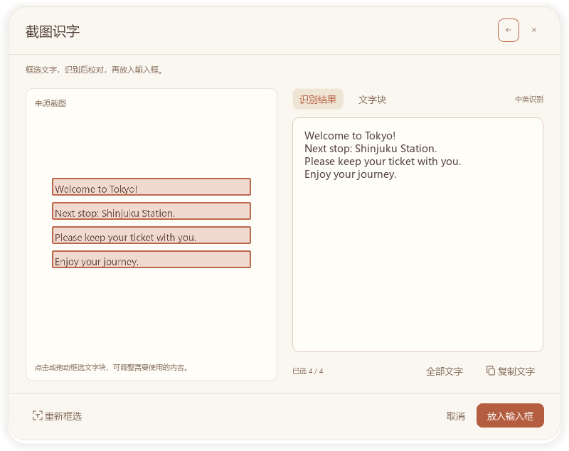

# 使用指南

图中为隔离配置中的示例文字和文字块，用于展示选择、校对与确认操作。

安装包用户从开始菜单“Murmur（译语）”启动。源码用户按仓库 `README.md` 准备环境和模型，再运行根目录 `start-translator.bat`。窗口标题为“Murmur（译语）”，当前版本为 0.5.0。

## 输入与翻译

输入或粘贴原文，选择原文语言、目标语言以及翻译平台，点击发送或按 `Ctrl+Enter`。Argos 提供中英基础离线翻译；在线平台需要先在设置中保存自己的账户凭据。

点击语言选择器，可按中文名、英文名或语言代码搜索，按 Enter 确认、Esc 关闭。语种范围随平台变化，源语言可以自动识别，目标语言必须明确选择；切换平台时保留仍受支持的语种，其他选择恢复为自动源语言和中文目标。各平台范围见[在线平台配置](providers.md)。

原文与译文作为会话消息展示，译文下方可以复制。长内容在聊天区滚动，输入区保持固定。请求执行期间可以取消；更改输入、语言或平台后，旧任务的迟到结果不会覆盖新的内容。

## 截图与图片识字

点击截图入口或按 `Ctrl+Alt+S`，在鼠标所在显示器选择区域。输入区也支持添加图片和粘贴图片。识字在本机完成，校对窗口显示来源图片与识别文字。

点选、拖选或全选文字块，必要时校对文字，再明确确认放入输入框。确认前不修改已有输入，取消保留原文。截图区域不跨显示器；全局快捷键被占用时仍可点击窗口或托盘入口截图。

## 会话与设置

历史入口支持搜索、打开和删除本地会话；`Ctrl+K` 打开历史，`Ctrl+N` 开始新会话。记录保存在本机，包含原文、译文与可选截图缩略图。系统凭据与聊天记录分别存储，删除会话不会删除平台密钥。

设置包括常规、字体与外观、平台与模型、截图识字。字体、字号、行距和主题立即生效并保存。平台字段及账户入口见[在线平台配置](providers.md)。保存设置不发送请求，主动连接验证仅发送固定短句 `Hello.`。

需要查看配置文件时，在“设置 → 常规”点击“打开配置目录”。安装版与源码版均使用 `%APPDATA%/Murmur/`：`settings.json` 保存设置及凭据引用，`history.json` 保存聊天记录。手动修改设置前先通过托盘退出程序，保持 JSON 格式有效，修改后重新启动。请保留平台的 `credential_id`，否则程序无法找到已保存的系统凭据。

密钥保存在 Windows 系统凭据存储中，可在“设置 → 平台与模型”勾选“显示凭据”查看和修改，保存后生效。打开配置目录只显示本地文件，不导出密钥。

## 收起与退出

关闭主窗口后程序继续运行并显示浮动图标，按住左键拖动、双击恢复；也可通过托盘恢复。退出使用托盘菜单“退出”。重复启动只唤回已有窗口。

## 排查

- 安装包问题：运行开始菜单中的“运行自检”；资源缺失时重新安装完整测试包。
- 源码环境错误：运行 `start-translator.bat --check` 检查根目录 `.venv`。
- 模型缺失或损坏：按仓库 `README.md` 的模型准备步骤准备模型，运行期间不会自动下载。
- 在线翻译失败：核对当前平台凭据、服务开通状态与账户权益，主动验证连接。
- 配置或历史损坏：保留原文件进行修复，程序不会用空数据覆盖损坏文件。

离线模型可能误译动作、否定与术语，重要内容请人工复核。不同 Windows 版本、混合 DPI 与多显示器环境需要在目标机器验证。
